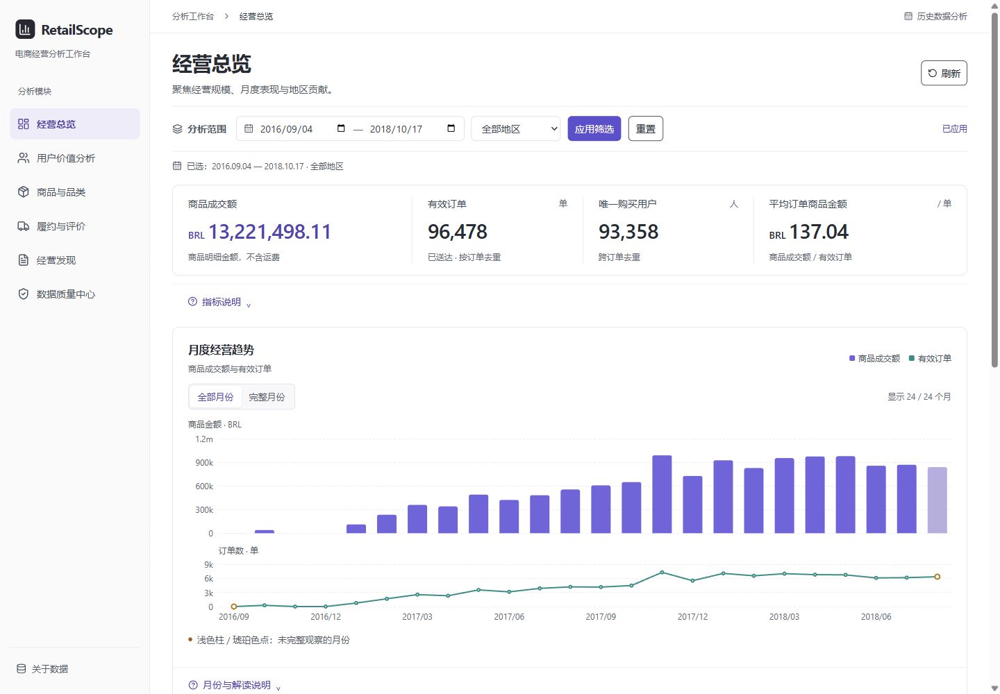
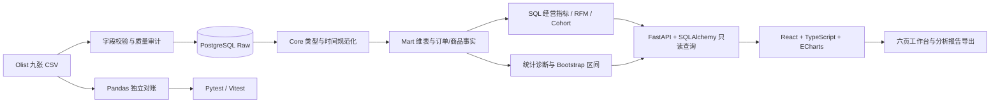
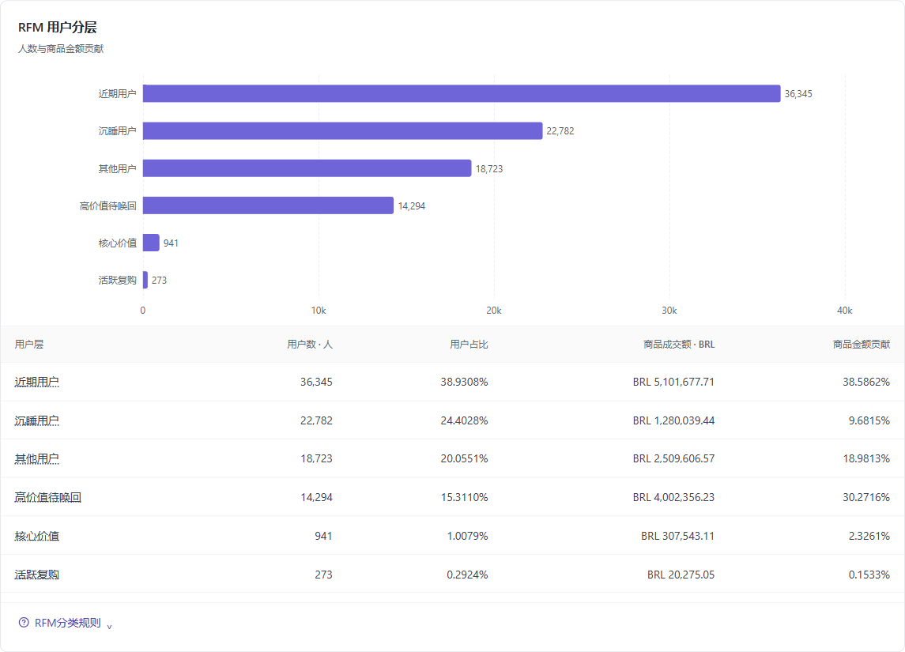
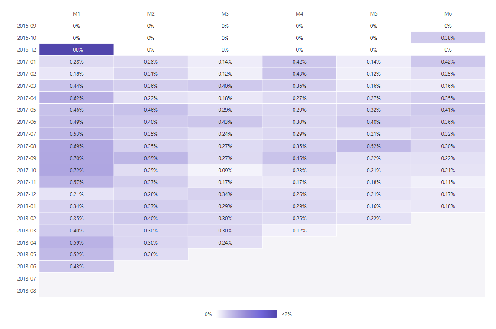

# RetailScope｜电商经营分析工作台

基于 Olist 公开历史订单，连接真实数据处理、SQL 分层数仓、用户价值分析与统计诊断的交互式经营分析作品。围绕销售趋势、品类贡献、用户复购和履约体验，支持筛选、追溯与报告导出。



**React · TypeScript · FastAPI · PostgreSQL 16 · Python 3.12 · ECharts**

**9 张原始表 / 155 万条记录 · 96,478 笔有效订单 · 7 项统计发现 · 144 项后端 + 28 项前端测试通过**

## 六个分析模块

| 模块 | 核心内容 | 实际页面 |
|---|---|---|
| 经营总览 | 商品成交额、订单与购买用户、月度趋势、状态和地区贡献 | [截图](docs/screenshots/showcase/overview.png) |
| 用户价值 | RFM 六类分层、购买频次、Cohort 回购活跃留存 | [截图](docs/screenshots/showcase/users.png) |
| 商品品类 | 中文类目搜索、TOP10 / 全量排行、帕累托与月度结构 | [截图](docs/screenshots/showcase/products.png) |
| 履约评价 | 配送时长、逾期率、地区表现与评价关联 | [截图](docs/screenshots/showcase/delivery.png) |
| 经营发现 | 7 项发现、样本与方法依据、置信区间、Markdown 报告 | [截图](docs/screenshots/showcase/findings.png) |
| 数据质量 | 当前数据规模、历史审计、缺失与重复、构建与对账记录 | [截图](docs/screenshots/showcase/quality.png) |

日期、客户州和类目筛选使用相同的已应用范围；支持 CSV、Markdown、JSON 导出。用户分层、留存与统计发现采用固定全样本，页面明确区分其适用范围。

## 数据规模与分析结果

| 指标 | 结果 |
|---|---:|
| 原始数据 | 9 个 CSV，1,550,922 行 |
| 全状态订单 | 99,441 单 |
| 已送达有效订单 | 96,478 单 |
| 唯一购买用户 | 93,358 人 |
| 商品成交额 | BRL 13,221,498.11 |
| 平均订单商品金额 | BRL 137.04 |
| 观察期复购率 | 3.0003% |
| 平均配送天数 / 逾期率 | 12.56 天 / 6.7731% |

交易指标以有效 `delivered` 订单及购买日期为准；用户按 `customer_unique_id` 跨订单去重。商品成交额为商品明细 `price` 汇总，运费单列。支付、评价先按订单聚合再关联，防止 JOIN 放大金额；跨品类订单总量重新去重。

完整定义见 [指标口径](docs/METRICS.md) 和 [数据模型](docs/P1_DATA_MODEL.md)。

## 技术架构



- **数据层**：Python、Pandas、SQLAlchemy、PostgreSQL；Raw 保留源值，Core 统一类型，Mart 明确事实粒度并预聚合一对多关系。
- **分析层**：SQL、NumPy、SciPy；完整月趋势、MAD 异常回顾、品类 HHI、RFM、Cohort、用户整群 Bootstrap。
- **应用层**：FastAPI、React、Vite、Tailwind CSS / shadcn/ui、Apache ECharts；参数化 SQL、页面懒加载和统一筛选状态。
- **工程验证**：Docker Compose、Pytest、Vitest、独立 Pandas 对账与真实浏览器检查。

更多结构见 [系统架构](docs/ARCHITECTURE.md)。

## 用户价值与统计分析

RFM 以 **2018-08-30** 为基准日，根据最近购买、有效订单次数与累计商品金额进行六类规则分层；五分位边界同值同分。Cohort 按样本内首次有效购买月份分组，同一用户同月去重，默认聚焦 M1–M6，可查看全部月龄；552 个单元中，298 个尚未完整观察的值保留为 NULL。

| RFM 用户结构 | Cohort 回购活跃留存 |
|---|---|
|  |  |

配送逾期与评价分析比较 6,381 笔逾期订单和 89,443 笔未逾期订单，订单等权评价均分差约 **-2.0188 分**，按唯一用户整群 Bootstrap 的 95% 区间为 **[-2.0575, -1.9800]**。这是观察性关联；评分均分与“每单最新评分≤2”的低评分比例使用不同口径。

[统计证据截图](docs/screenshots/showcase/statistical-evidence.png) · [统计方法](docs/P3_ANALYSIS_METHODS.md) · [分析报告](docs/P3_BUSINESS_REPORT.md)

样本缺少成本、完整退款、曝光与实验分配，因此结果主要用于历史经营描述与待验证建议；不计算净利润，也不将观察期变化解释为干预效果或未来预测。

## Windows 本地运行

已验证：Windows 11、Python 3.12.10、Node.js 24.15.0 / npm 11.12.1、PostgreSQL 16.16。准备 Python 3.12、Node.js 24 和采用 WSL 2 后端的 Docker Desktop，启动 Docker 引擎后进入工程根目录。

### 首次准备

```powershell
git clone https://github.com/yc081416-ops/retailscope.git
cd retailscope
powershell -NoProfile -ExecutionPolicy Bypass -File .\start.ps1 -Action init
powershell -NoProfile -ExecutionPolicy Bypass -File .\start-v2.ps1 -Action install
```

`init` 创建缺失的 Python 环境和本地随机密码配置，使用 kagglehub 下载官方九份 CSV，校验后入库、建仓并生成分析快照；已有有效数据则检查并复用，已有 `.env` 保留。若官方要求认证，按终端提示在本机完成。配置字段见 [.env.example](.env.example)，依赖按锁文件安装。

### 日常启动

```powershell
powershell -NoProfile -ExecutionPolicy Bypass -File .\start.ps1 -Action start -NoServe
```

随后分别在两个终端运行：

```powershell
# 终端一：API
powershell -NoProfile -ExecutionPolicy Bypass -File .\start-v2.ps1 -Action api
```

```powershell
# 终端二：前端
powershell -NoProfile -ExecutionPolicy Bypass -File .\start-v2.ps1 -Action web
```

访问 [工作台](http://127.0.0.1:5173)；[API 文档](http://127.0.0.1:8000/docs)。服务在本地运行。启动后可执行 `powershell -NoProfile -ExecutionPolicy Bypass -File .\start-v2.ps1 -Action check` 核对前端和真实 SQL。

本地演示构建（保持 API 运行）：

```powershell
npm --prefix frontend run build
npm --prefix frontend run preview -- --port 5174
```

访问 [构建预览](http://127.0.0.1:5174)。前端/API 在各终端按 Ctrl+C 停止；数据库使用 `start.ps1 -Action stop` 停止并保留数据卷，使用 `start.ps1 -Action restart -NoServe` 重启。源码或分析输入变更后，按提示显式执行 `start.ps1 -Action refresh` 更新派生快照并保留旧报告。

原版 Streamlit 源码作为历史实现保留在 `app/`，当前演示入口以上述 React 工作台为准。

## 运行测试

先完成数据初始化；测试包含真实数据库、官方 CSV 和本地聚合快照对账。

```powershell
.\.venv\Scripts\python.exe -m pytest -q -rA --junitxml=reports/github-release/pytest.xml
npm --prefix frontend test
.\frontend\node_modules\.bin\tsc.cmd -b frontend/tsconfig.json
npm --prefix frontend run build
```

完整执行 **144 项 Pytest、28 项 Vitest**，类型检查和生产构建通过。覆盖 JOIN 防重复计数、指标一致性、RFM / Cohort、统计区间、筛选、导出和边界状态。运行证据与复现范围见 [发布检查](docs/GITHUB_FINAL_RELEASE_REPORT.md)。首次安装流程已提供，本轮未在全新电脑重新验证。

## 数据来源与许可

数据：[Olist Brazilian E-Commerce Public Dataset / Kaggle](https://www.kaggle.com/datasets/olistbr/brazilian-ecommerce)，使用版本 2，许可为 [CC BY-NC-SA 4.0](https://creativecommons.org/licenses/by-nc-sa/4.0/)。本项目为个人非商业分析作品；衍生聚合报告与截图保留数据署名和许可要求，处理说明见 [数据许可](docs/DATA_LICENSE.md)。

项目作者拥有权利的原创代码采用 [MIT License](LICENSE)，版权署名为 `Copyright (c) 2026 [yan]`。MIT 不覆盖第三方库、引用组件、Olist 原始数据及受其他许可约束的内容；依赖和组件保留各自的版权与许可，见 [第三方许可](docs/THIRD_PARTY_LICENSES.md)。

数据相关报告、聚合结果和截图继续保留 CC BY-NC-SA 4.0 来源与要求；混合材料的具体适用范围列为 [待审查项](docs/DATA_LICENSE.md#混合材料的适用范围)，不将整个仓库统一标为 MIT。原始 CSV、用户级导出、数据库备份和本地凭证不随公开仓库分发，运行时通过官方下载流程准备数据。

## 项目材料

[简历项目描述](docs/RESUME_PROJECT.md) · [面试问答](docs/INTERVIEW_GUIDE.md) · [演示脚本](docs/DEMO_SCRIPT.md) · [公开文件清单](docs/GITHUB_PUBLIC_FILES.md)
