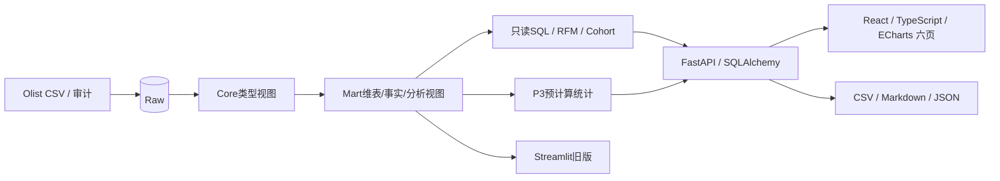
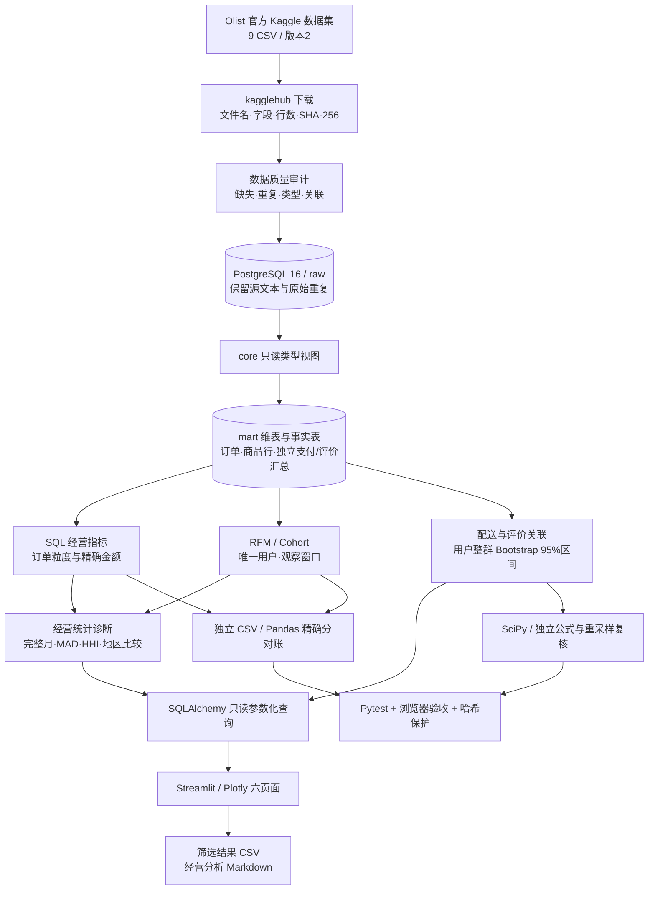

# RetailScope 系统架构

## V2正式工作台架构

主产品为React/TypeScript + FastAPI六页，旧版Streamlit单独保留。SQL与统计模型仍复用P1/P3，API只读；Markdown原字节下载、JSON质量证据及CSV都区分来源/范围。页面级懒加载与zrender独立分包在生产构建真实验证。

下方保留旧版与数据流水线架构说明；当前安装与启动以主 README 为准。

个人非商业电商分析作品。真实Olist数据经审计、分层建模和独立统计复核后进入六页面BI；无付费服务、无虚构订单、无公网发布。

## 粒度与关联约束

- raw九表总计1,550,922行，订单主表99,441行；原地理表包含重复，保留以便追溯。
- 用户维表以customer_unique_id为键；customer_id是订单客户桥。订单地区取该单客户州，不能给跨单用户强行固定一个州。
- mart.order_wide一订单一行；mart.order_item_fact主键为(order_id,item_id)。商品金额、支付和评价分别预聚合后再连订单，避免多对多放大。
- 地理表先整行去重、按五位邮编汇总至唯一键，再由维表关联。未覆盖邮编不删除订单。
- 日期/月份结构与P1分析上下文统一，Cohort未完整观察单元保持NULL。

## 模块边界

| 路径 | 职责 |
|---|---|
| src/retailscope/contracts.py、audit.py、download.py | 源文件契约、审计及官方下载 |
| database.py、verification.py | raw建表、事务COPY、行数/内容幂等核查 |
| sql/10_core.sql、20_mart.sql、30_customer.sql | 类型、维表/事实、指标、RFM/Cohort |
| warehouse.py、p1_validation.py | 事务建仓、SQL导出、独立CSV/Pandas复核 |
| sql/p3、diagnostics.py | 只读诊断SQL、统计计算、结构化结果和报告 |
| bi/data.py | SQLAlchemy只读连接池、查询白名单、绑定筛选及缓存 |
| bi/components.py、diagnostic_page.py | 统一图表/导出、版本化快照选择、统计呈现 |
| app/Home.py、app/pages | 六页面导航、布局和交互 |
| runtime.py、start.ps1 | 首装、只读就绪检查、版本化更新、启动/停止 |
| tests、scripts/*verify* | 边界、真实SQL、独立统计、浏览器和公开范围验收 |

## 首装与日常运行

`start.ps1 -Action init`只在缺少虚拟环境时创建它，只在缺少.env时生成随机密码配置。空raw才导入；完整已有raw/mart只验证，不隐式重载。每次首装/显式更新的报告保存在reports/runtime/runs/时间戳，不覆盖P0–P3历史报告。

`start.ps1`日常启动等待Compose数据库健康后，还会检查仓库、P3输入哈希及快照一致性，最后启动Streamlit。检查不通过则停止，不使用模拟数据兜底。

`start.ps1 -Action refresh`是显式更新：保留raw，只重建derived core/mart并生成新版本诊断；既有报告不覆盖。页面通过reports/runtime/active.json选择新快照。源CSV变化时不自动覆盖已有raw，应保留旧库，在新空数据库验证更新。

## 结果与安全

原始CSV、用户级临时导出、.env、虚拟环境、卷/备份和日志不进入公开Git候选集。docs/screenshots只放实际页面的聚合截图。SQLAlchemy查询会话只读，用户选择仅绑定为参数；错误提示和日志不输出连接串与密码。

本地Docker卷持久化数据，停止用`start.ps1 -Action stop`，重启用`-Action restart`；不执行down -v或卷删除。隔离复现采用同一主机上的干净Python虚拟环境与另一个空数据库，不等同于全新操作系统验证。
