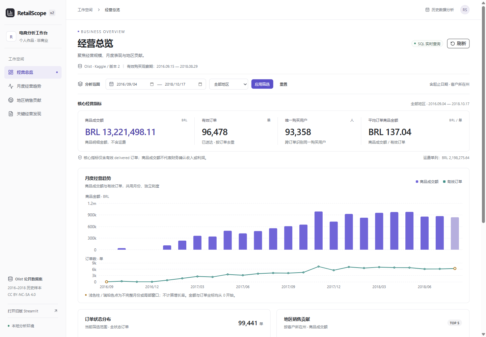
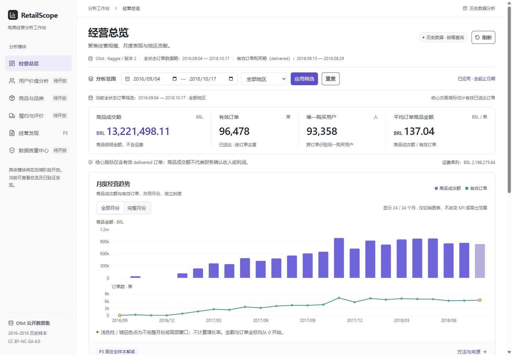

# V2-01.1 经营总览设计修改对比

版本号仅用于开发文档。本次只精修总览的呈现、信息架构与已有接口上的交互，未修改API、SQL或统计模型。旧版Streamlit开发入口仍见[启动说明](../api/README.md)，不放在正式展示导航中。

| 内容 | V2-01 修改前 | V2-01.1 修改后 |
|---|---|---|
| 字体 | 标题27px、导航12px、辅助多为11px | 标题29px、导航/正文14px、辅助至少12px、重要说明13px；轴/图例12px |
| 对比度 | 多处小字及浅色说明 | 正文次色#565D69，对白底约6.63:1；图表轴/辅助#626771 |
| 品牌与身份 | Logo版本、R工作区装饰、RS头像 | 移除虚拟身份与版本标签，保留产品名和一句定位 |
| 侧栏 | 月度/地区页面锚点与业务导航混排、旧版链接 | 六模块结构；总览及P3发现可用，其他四模块显式禁用/待开放，无假链接 |
| 数据时效 | “SQL实时查询” | “历史数据·按需查询”，明确全状态数据期与delivered有效购买期 |
| 筛选 | 11px控件/提示，应用与重置样式差异较大 | 14px控件、统一36px按钮与边框；待应用和当前全状态筛选范围同时保留 |
| KPI | 金额与BRL同等字号、列内小字较小 | 数字30px/27px，BRL前缀14px，标签14px/注释12px；统一基线，金额精度不变 |
| 趋势 | 分离纵轴，固定全部月份，无摘要 | 保留两个零起点坐标；增加全部/完整月份查看切换、观察标识和P3固定全样本解读 |
| 解读范围 | 仅经营发现入口 | 图表下显示真实P3 F01结果、期间和查询标识；局部筛选另加醒目的固定全样本边界 |
| 地区 | 静态排行和展开 | 客户州名称是实际筛选按钮；沿用当前已应用日期范围，立即更新所有KPI/图表与控件 |
| 订单状态 | 全状态解释为小字 | 标题下与页脚明确同范围全状态订单；与有效交易地区贡献分别标明 |
| 错误与空状态 | 既有行为 | 保留并重新验证，使用更清晰的字体和解释；不展示伪造指标 |

## 视图与统计边界

默认仍为全部24个月，保留早期数据。完整月视图仅按已有SQL的is_complete标记选择22个月，不增加新统计判定；局部窗口完整月数会相应变化。切换只改变图表，不改变KPI或CSV导出的筛选范围，界面明确提示。

P3 F01解释直接读取现有/api/findings的已验收结果，没有另写增长或异常算法。全样本与局部筛选均标“P3固定全样本解读”，局部范围额外显示“不代表当前日期或地区的趋势”。未把历史P3结果假装成当前筛选结论。

地区点击沿用已应用scope而非尚未应用的草稿：点击SP等价于将当前结果的客户州设为SP，并同步日期/州输入框。若日期还有未应用改动，点击地区会回到当前已应用日期，避免将未确认草稿悄悄提交。筛选查询和CSV逻辑仍使用V2-01接口。

## 真实页面对比

修改前（V2-01，1440×1000）：

修改后（V2-01.1，1440×1000）：

- [1280px修改后首屏](screenshots/v2-01-1/overview-1280.png)
- [1440px修改后全页](screenshots/v2-01-1/overview-1440-full.png)
- [1280px修改后全页](screenshots/v2-01-1/overview-1280-full.png)
- [真实悬停提示](screenshots/v2-01-1/trend-tooltip.png)
- [局部筛选与固定全样本提示](screenshots/v2-01-1/filtered-overview.png)

旧V2-01截图/报告不覆盖；阶段开始的前端源码另保存在本地reports/v2-01-1/before。新版使用独立overview.css，原workbench.css保留但不再导入，避免两套样式互相覆盖。

本次未添加新API、分析算法、其他新版页面、账户系统、预测或公网部署。首屏优先显示核心指标与主要趋势；P3说明、次级图表和导出通过正常纵向滚动查看。
