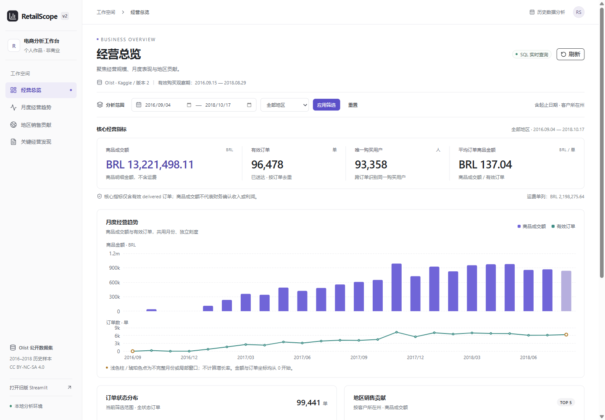

# RetailScope V2-01 验收报告

日期：2026-11-13。本阶段仅交付新版经营总览及真实只读API，功能验证完成，等待用户视觉验收。没有开发其他五个新版页面，没有进入V2-02，没有推送GitHub或部署公网。

## 实际交付

- 同一工程新增frontend（React/TypeScript/Vite、Tailwind CSS、shadcn/ui、Apache ECharts）与api（FastAPI）。原有Streamlit保留并实际可用。
- 统一设计：白色主背景、低饱和中性导航、克制的紫/青图表；窄侧栏、统一边框/字号/数值格式。四项KPI与主要趋势位于首屏，不采用双轴混合量纲。
- 日期及客户州筛选、待应用提示、重置、四类CSV导出、7项既有P3发现入口、加载/空结果/错误与重试。
- 设计规范：[V2-01_DESIGN_SPEC.md](V2-01_DESIGN_SPEC.md)；接口/安装说明：[api/README.md](../api/README.md)。

## 实际环境与启动

Windows 11；Python3.12.10；Node24.15.0、npm11.12.1；PostgreSQL16.16。React19.3.1、Vite8.3.8、TypeScript7.0.2、Tailwind4.3.5、ECharts6.1.0；FastAPI0.162.5、Uvicorn0.54.0。依赖以frontend/package-lock.json与api/requirements-lock.txt为准，未改写旧版requirements-lock.txt。

```powershell
# 前提：既有Python环境和P1/P3仓库已按原README就绪
powershell -NoProfile -ExecutionPolicy Bypass -File .\start-v2.ps1 -Action install
# 在两个终端分别运行
powershell -NoProfile -ExecutionPolicy Bypass -File .\start-v2.ps1 -Action api
powershell -NoProfile -ExecutionPolicy Bypass -File .\start-v2.ps1 -Action web
# 第三个终端实际SQL与前端检查
powershell -NoProfile -ExecutionPolicy Bypass -File .\start-v2.ps1 -Action check
```

新版：http://127.0.0.1:5173；API：http://127.0.0.1:8000/docs；旧版：http://127.0.0.1:8501。停止V2在各自终端按Ctrl+C，数据库继续沿用start.ps1的stop/restart流程。所有服务仅本地绑定，不改.env。

实际安装了前后端依赖，完成TypeScript检查和Vite生产构建；实际启动了FastAPI与Vite开发服务。start-v2.ps1的API启动和check已执行；安装命令等价的pip锁定依赖安装/npm安装已执行，未声称在全新OS验证。

## 指标与数据保护

API直接复用retailscope.bi.data中既有SCOPE、FILTERED、FIXED SQL，读取mart.order_wide与既有汇总。没有重新实现分析算法、重建数仓或更改P1口径。支付、评价不会与商品明细多对多直接相乘。

| 默认核心指标 | 实际SQL/API/浏览器结果 |
|---|---:|
| 商品成交额 | BRL 13,221,498.11 |
| 有效订单 | 96,478 单 |
| 唯一购买用户 | 93,358 人 |
| 平均订单商品金额 | BRL 137.04（展示） |

原始API平均金额保留精度为137.0415857501191982，金额以Decimal字符串返回，展示时格式化。状态图为同日期/地区全部状态，共99,441单；交易KPI、月度趋势和地区贡献为有效订单。日期主要使用购买时间，含首尾日并在SQL转为次日exclusive边界。

默认筛选覆盖日期维表2016-09-04至2018-10-17，保证含全状态结果；有效购买观察期单独标示2016-09-15至2018-08-29，二者不混同。不完整月份通过SQL is_complete标识，不计算增长率或预测。

最终只读核对：九张raw及全部mart内容指纹与阶段开始一致；36个受保护历史文档/SQL/.env文件SHA-256未变。旧版源码、SQL、指标文档和历史报告未修改。证据reports/v2-01/baseline.json与final_verification.json。

## 真实接口与安全

- GET /api/overview：四项KPI及monthly/statuses/regions和元数据；单一REPEATABLE READ只读事务提供一致快照。
- GET /api/overview/export：table限定kpis/monthly/statuses/regions；所有CSV包含已应用的scope_start、scope_end、scope_state。
- GET /api/findings：读取现有P3快照，七项发现与已验收文件逐项一致；明确固定全样本，不伪装与局部筛选联动。
- 参数化SQL、客户州白名单、日期类型校验；非法州/倒置日期/注入尝试/非法导出字段拒绝。无任意SQL执行入口。
- default_transaction_read_only=on、连接超时5秒、语句超时20秒、有限连接池；真实查询SHOW验证只读及REPEATABLE READ。
- 故障提示503不返回连接串、密码或SQL；中间件只记录异常类型和接口路径，实际停库后的当前日志没有异常堆栈或连接详情。
- Git候选文件安全扫描通过，原始CSV、.env、用户级导出、日志、node_modules、dist均忽略；无暂存文件、无远端、无发布。npm audit本次结果0已知漏洞，不等同完整安全审计。

## 实际浏览器交互

| 验收项 | 结果 |
|---|---|
| 加载与默认值 | 真实延迟请求期间显示加载状态；完成后4项基线准确 |
| 1440×1000 | 无横向溢出、KPI截断；主要趋势底部899.3px，首屏完整可见 |
| 1280×900 | 无横向溢出、KPI截断；主要趋势底部891.8px，首屏完整可见 |
| 图表 | 两个ECharts SVG容器，包含金额/订单上下趋势与状态横条；地区贡献为真实API排名表/条 |
| 地区展开 | 全部27州与SQL行数一致，可收起 |
| 日期+地区 | 2017-05-10至2017-06-20、SP：BRL250,817.27，1,900单、1,863人，平均BRL132.01 |
| 待应用 | 修改筛选后旧结果保持，并显示中文“更改待应用”；应用后KPI与图表同时更新 |
| 导出 | 实际下载retailscope-monthly.csv，所有数据列及筛选列与当前真实API/SQL逐项一致 |
| 空范围 | 2020-01-01至2020-01-02显示0、0、0、平均金额“—”，不伪造数据 |
| 非法日期 | 中文提示开始日期不能晚于结束日期；未触发错误查询 |
| 重置 | 恢复全样本4项KPI |
| 发现入口 | 打开对话框显示7项既有发现、范围、方法、限制和待验证建议，Esc可关闭 |
| 数据库异常 | 真实compose stop后503与中文重连提示；旧KPI隐藏，防止误用过期数据 |
| 恢复 | compose up --wait后点击重新连接，恢复全样本KPI |
| 旧版 | 真实浏览器打开Streamlit：4项基线、3张图、0异常组件 |
| JS运行 | 完整交互过程中0 pageerror |

截图均为实际运行页面，已逐张/重点视觉检查，不是效果图。普通纵向滚动用于次级图表、导出和页尾；发现弹窗内部滚动为内容需要，无额外水平滚动条。

### 截图



- [1280px首屏](screenshots/v2-01/overview-1280.png)
- [1440px全页](screenshots/v2-01/overview-1440-full.png)
- [1280px全页](screenshots/v2-01/overview-1280-full.png)
- [真实筛选结果](screenshots/v2-01/filtered-overview.png)
- [经营发现入口](screenshots/v2-01/findings-entry.png)

加载/空结果/停库截图和旧版截图另保存在output/playwright/v2-01，本地忽略。

## 测试及运行证据

最终全量 **103 passed，0 failed，0 errors，0 skipped**：原有86项全部通过，新增17项API用例。测试没有改写原有统计断言；独立SQL核对多个日期/州组合、各图表合计、四类CSV、空/部分月份、非法输入、只读隔离级别、脱敏响应/日志及P3发现一致性。

| 证据 | 路径 |
|---|---|
| 全量测试日志/XML | reports/v2-01/pytest.log、pytest.xml |
| 前端类型检查/生产构建 | reports/v2-01/frontend_build.log |
| 当前后端/前端实际运行 | reports/v2-01/api_current.log、vite.log |
| 六类交互与尺寸验证 | reports/v2-01/browser.log |
| 停库/恢复 | reports/v2-01/db_stop.log、db_restart.log、failure_browser.log、recovery_browser.log |
| 旧版真实浏览器 | reports/v2-01/legacy_browser.log |
| 导出与独立对账 | reports/v2-01/browser-filtered-monthly.csv、final_verification.json |
| 环境安装/启动 | reports/v2-01/api_install.log、api_lock_install.log、startup_check.log |
| 安全 | reports/v2-01/public_safety.log、npm_audit.json |
| 最终保护及清单 | reports/v2-01/final_verification.json、modified_files.json |

初次断连实验发现ASGI默认异常处理会将原始异常重新抛给服务日志，因此在本阶段改成脱敏中间件，并再次真实停库验证；旧api.log保留为本地历史运行记录，不公开。当前日志api_current.log仅记录类型，不泄漏连接信息。

## 已知限制与未验证范围

1. 仅本机开发模式浏览器验收；完成生产构建，但没有生产托管、身份认证、并发压测或公网部署，未验证全新Windows环境。
2. 当前生产JS单包约850KB、gzip约282KB，Vite提示大于500KB的包体警告；构建成功。本阶段单页本地展示可用，未将告警隐藏或宣称生产加载优化完成。
3. 原生日期控件的显示格式由系统区域设置决定；中文标签、错误提示与ISO API契约一致。没有为本阶段引入大型日期组件。
4. 不含其他五个新版页面；导航只指向当前页锚点、已验收发现入口与明确标注的旧版。没有用空页面冒充完成。
5. 数据为历史样本；不完整月份不推断增长；商品金额不等于收入利润；P3发现只读复用，没有新增因果推断或预测。
6. 未改变P0–P4数据与报告；README新增V2入口，P4历史数字保留并明确阶段含义。

在上述范围内，V2-01工程/数据/交互验证完成，等待用户确认视觉效果。停止在V2-01，不继续开发V2-02。

## 修改文件清单

- `README.md`
- `.gitignore`
- `scripts/audit_public.py`
- `api/README.md`
- `api/__init__.py`
- `api/main.py`
- `api/requirements-lock.txt`
- `api/requirements.txt`
- `docs/V2-01_ACCEPTANCE_REPORT.md`
- `docs/V2-01_DESIGN_SPEC.md`
- `docs/screenshots/v2-01/filtered-overview.png`
- `docs/screenshots/v2-01/findings-entry.png`
- `docs/screenshots/v2-01/overview-1280-full.png`
- `docs/screenshots/v2-01/overview-1280.png`
- `docs/screenshots/v2-01/overview-1440-full.png`
- `docs/screenshots/v2-01/overview-1440.png`
- `frontend/components.json`
- `frontend/index.html`
- `frontend/package-lock.json`
- `frontend/package.json`
- `frontend/public/favicon.svg`
- `frontend/src/App.tsx`
- `frontend/src/Chart.tsx`
- `frontend/src/charts.ts`
- `frontend/src/components/ui/badge.tsx`
- `frontend/src/components/ui/button.tsx`
- `frontend/src/components/ui/dialog.tsx`
- `frontend/src/index.css`
- `frontend/src/lib/utils.ts`
- `frontend/src/main.tsx`
- `frontend/src/types.ts`
- `frontend/src/workbench.css`
- `frontend/tsconfig.json`
- `frontend/vite.config.ts`
- `scripts/v2_browser_check.js`
- `scripts/v2_failure_check.js`
- `scripts/v2_legacy_check.js`
- `scripts/v2_recovery_check.js`
- `scripts/verify_v2_final.py`
- `scripts/write_v2_report.py`
- `start-v2.ps1`
- `tests/test_v2_api.py`

本地忽略证据：reports/v2-01、output/playwright/v2-01；旧版app/src/sql及.env未修改。没有批量删除或无理由移除已有文件。
